

**Quando o servidor principal cai, o DNS redireciona o tráfego sozinho para o secundário** 🔁☁️

---

## 📌 Sobre o projeto

Neste laboratório, configurei **roteamento de failover** com o **Amazon Route 53** para um site de cafeteria que roda em **duas instâncias EC2**, cada uma em uma **Zona de Disponibilidade** diferente.

O Route 53 monitora a instância principal com um **health check**. Se ela deixa de responder, o DNS passa a apontar automaticamente para a instância secundária, **sem intervenção manual**. Um alarme no **CloudWatch** envia um **e-mail** avisando sobre a falha.

As duas instâncias e a rede foram criadas pelo laboratório via **AWS CloudFormation**. Meu trabalho foi configurar a verificação de integridade, os registros DNS e testar o failover.

---

## 🎯 Objetivos

- ✅ Confirmar que o site do Café roda nas duas instâncias, em Zonas de Disponibilidade diferentes
- ✅ Criar um **health check** no Route 53 para o site principal
- ✅ Criar um **alarme** que envia **e-mail** quando o health check falha
- ✅ Criar **registros DNS (tipo A) com política de Failover**: primário e secundário
- ✅ Validar que o domínio resolve para o site principal
- ✅ **Simular uma falha** parando a instância principal e comprovar o failover

---

## 🗺️ Arquitetura

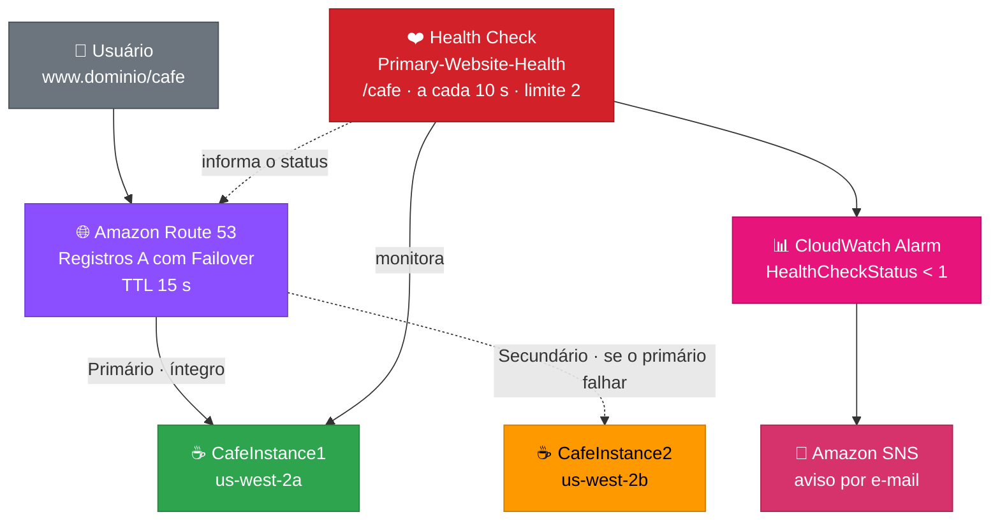

| 🔄 Situação | 🟢 Servidor que responde | 📝 O que acontece |
|---|---|---|
| **Normal** | CafeInstance1 (`us-west-2a`) | O health check está **Íntegro** e o DNS aponta para o registro **primário** |
| **Falha do primário** | CafeInstance2 (`us-west-2b`) | O health check fica **Não íntegro** e o DNS passa a responder com o registro **secundário** |

---

## 🧰 Serviços utilizados

| 🎨 Categoria | 🔧 Serviço | 📝 Função no projeto |
|:---:|:---:|---|
| 🌐 DNS | **Amazon Route 53** | Zona hospedada, registros A e roteamento de failover |
| ❤️ Monitoramento | **Route 53 Health Checks** | Verifica a saúde do site principal |
| ☁️ Compute | **Amazon EC2** | Duas instâncias com o site do Café |
| 📊 Monitoramento | **Amazon CloudWatch** | Alarme baseado na métrica `HealthCheckStatus` |
| 📧 Mensageria | **Amazon SNS** | Envio do e-mail de alerta |
| 🏗️ Infraestrutura | **AWS CloudFormation** | Criou as instâncias e a rede do laboratório |

---

## ⚙️ Configuração utilizada

| 🔹 Recurso | 🔸 Valor |
|---|---|
| **Região** | `us-west-2` (Oregon) |
| **Instâncias** | `CafeInstance1` (`us-west-2a`) e `CafeInstance2` (`us-west-2b`) · `t3.micro` |
| **Health check** | `Primary-Website-Health` |
| **Endpoint monitorado** | Endereço IP da CafeInstance1 · HTTP porta 80 · caminho `/cafe` |
| **Intervalo / limite de falha** | **10 segundos** (rápido) · **2** falhas consecutivas |
| **Alarme (CloudWatch)** | `Primary-Website-Health-awsroute53-alarm` · `HealthCheckStatus < 1` em 1 ponto de dados dentro de 1 minuto |
| **Notificação** | Tópico SNS `Primary-Website-Health` · e-mail |
| **Registro primário** | `www` · tipo **A** · IP da CafeInstance1 · TTL **15** · Failover **Primário** · ID `FailoverPrimary` · com health check |
| **Registro secundário** | `www` · tipo **A** · IP da CafeInstance2 · TTL **15** · Failover **Secundário** · ID `FailoverSecondary` · sem health check |

---

## 🪜 Passo a passo resumido

1. ☕ Confirmar que o site do Café abre nas **duas instâncias**, cada uma em uma Zona de Disponibilidade
2. ❤️ Criar o **health check** `Primary-Website-Health` apontando para o IP da CafeInstance1, caminho `/cafe`
3. 📊 Criar o **alarme no CloudWatch** (`HealthCheckStatus < 1`) com tópico SNS e confirmar a assinatura do e-mail
4. 🌐 Criar o **registro A primário** (`www`, Failover, com health check)
5. 🌐 Criar o **registro A secundário** (`www`, Failover, sem health check)
6. ✅ Abrir `www.<domínio>/cafe` e confirmar que responde o **site principal** (`us-west-2a`)
7. 🛑 **Parar a CafeInstance1** para simular uma falha
8. 🔴 Aguardar o health check ficar **Não íntegro**
9. 🔁 Atualizar o site e confirmar que agora responde a **CafeInstance2** (`us-west-2b`)
10. 📧 Conferir o **e-mail de alarme**

---

## 📸 Evidências

## ☕ Tarefa 1: Os sites do Café

### 1️⃣ Duas instâncias em execução
`CafeInstance1` (`us-west-2a`) e `CafeInstance2` (`us-west-2b`), ambas **Running** com **3/3 verificações** aprovadas.

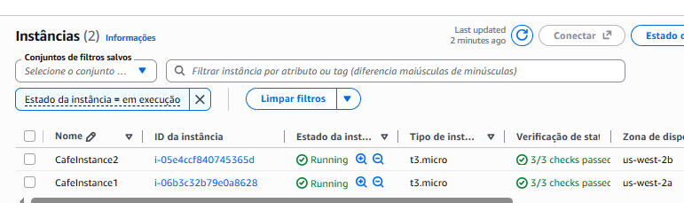

### 2️⃣ Site principal
O Café na CafeInstance1. A seção **Informações do servidor** mostra a Zona de Disponibilidade **us-west-2a**.

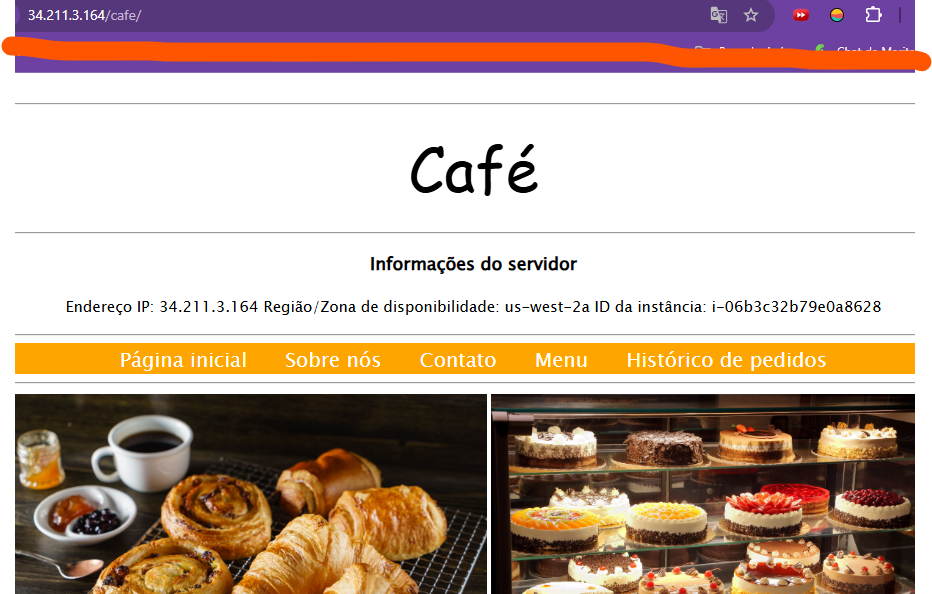

### 3️⃣ Site secundário
O mesmo aplicativo na CafeInstance2, agora na Zona de Disponibilidade **us-west-2b**.

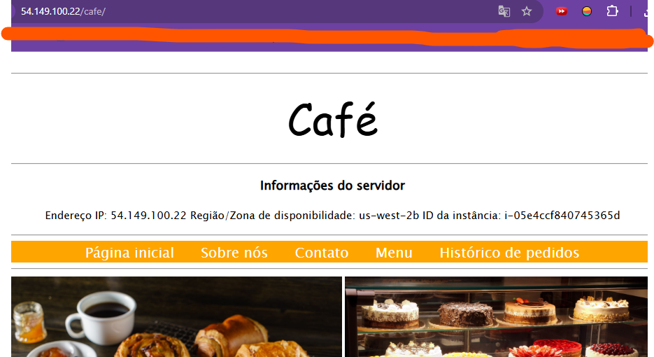

### 4️⃣ Pedido confirmado
Um pedido de teste (croissant e café com leite) com a página de confirmação, que mostra a hora do servidor.

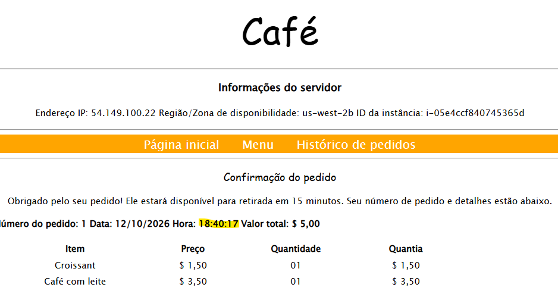

## ❤️ Tarefa 2: Health check e alarme

### 5️⃣ Alarme criado no CloudWatch
O alarme `Primary-Website-Health-awsroute53-alarm` monitorando `HealthCheckStatus < 1` em 1 ponto de dados dentro de 1 minuto. O valor **1** indica site íntegro, e o estado inicial é **OK**.

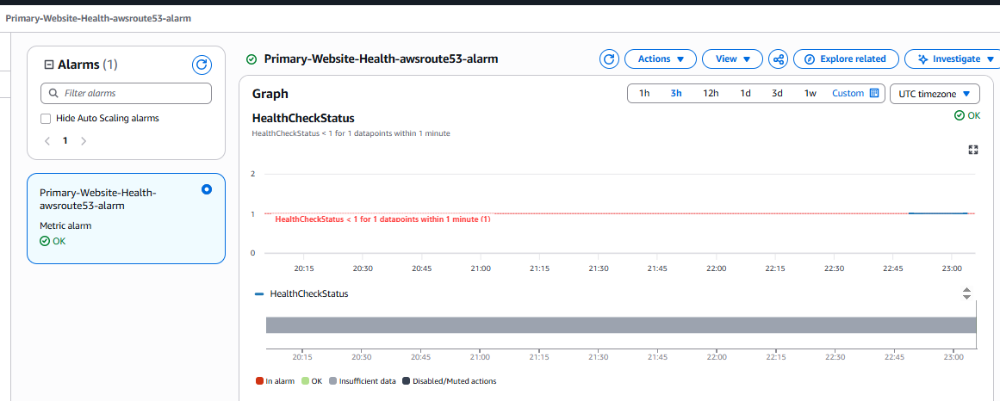

### 6️⃣ Health check íntegro
O `Primary-Website-Health` **Habilitado**, com status atual **Healthy** e o alarme associado em **OK**.

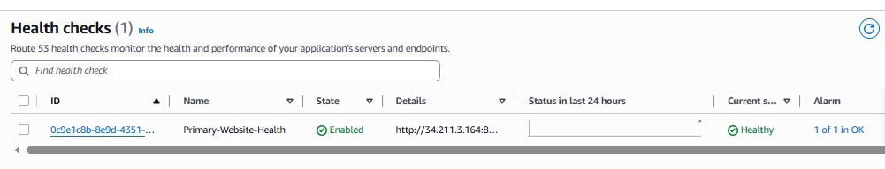

### 7️⃣ Assinatura do SNS
O e-mail de confirmação da assinatura no tópico SNS. Sem confirmá-la, o aviso do alarme não é entregue.

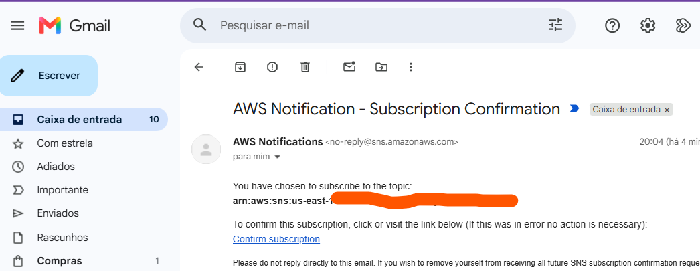

## 🌐 Tarefa 3: Registros DNS

### 8️⃣ Registros de failover na zona hospedada
Os dois registros **A** `www` com política **Failover**, um **Primário** e outro **Secundário**, ambos com **TTL 15**.

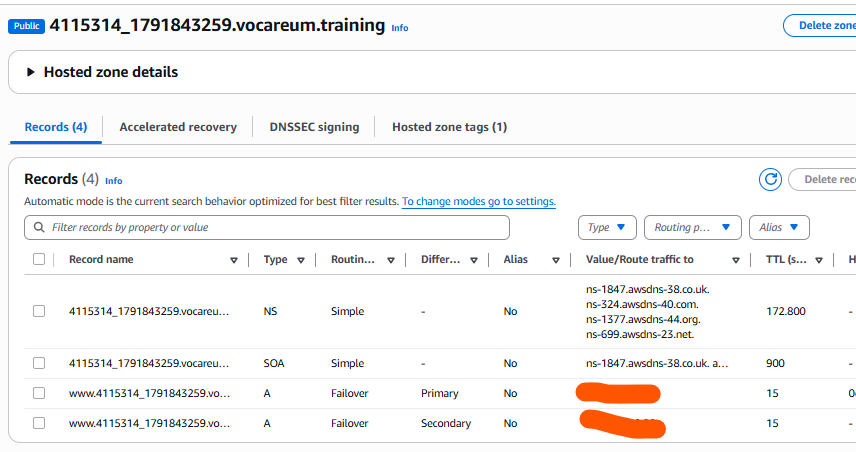

### 9️⃣ Detalhes do registro primário
Registro `www` tipo **A**, TTL **15**, política **Failover**, tipo **Primário**, ID `FailoverPrimary` e vinculado ao health check.

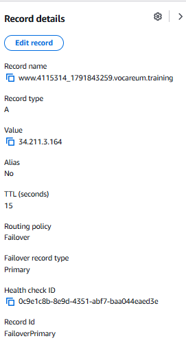

## ✅ Tarefa 4: Resolução de DNS

### 🔟 Domínio apontando para o site principal
Ao abrir `www.<domínio>/cafe`, o site responde pela **CafeInstance1**, na Zona de Disponibilidade **us-west-2a**.

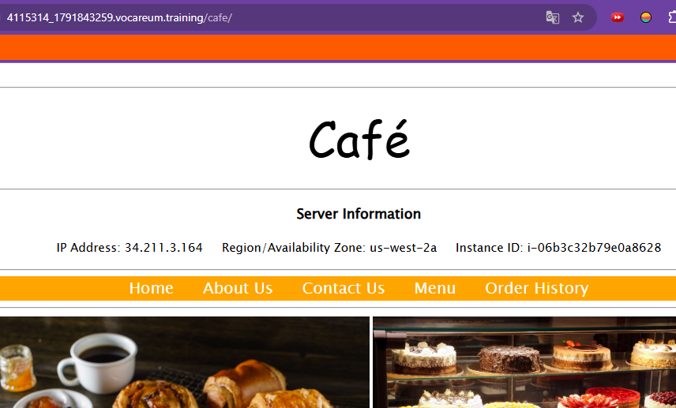

## 🔁 Tarefa 5: Failover

### 1️⃣1️⃣ Simulando a falha
A **CafeInstance1** em **Stopping**, enquanto a **CafeInstance2** continua em **Running**.

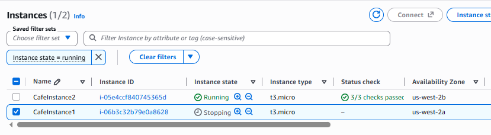

### 1️⃣2️⃣ Health check Não íntegro
O `Primary-Website-Health` passa a **Unhealthy**. O alarme ainda aparece como OK porque leva alguns instantes para atualizar.

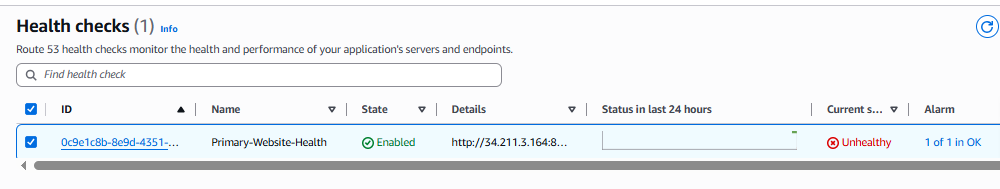

### 1️⃣3️⃣ Failover funcionando
O **mesmo endereço** `www.<domínio>/cafe` agora responde pela **CafeInstance2**, na Zona de Disponibilidade **us-west-2b**. O tráfego foi redirecionado sem nenhuma alteração manual.

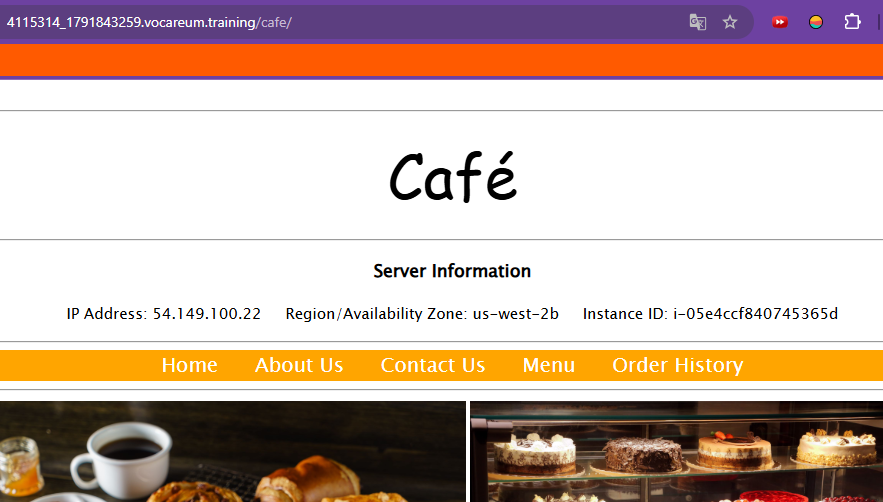

### 1️⃣4️⃣ E-mail de alarme
O aviso do **AWS Notifications** com o alarme `Primary-Website-Health-awsroute53-alarm`.

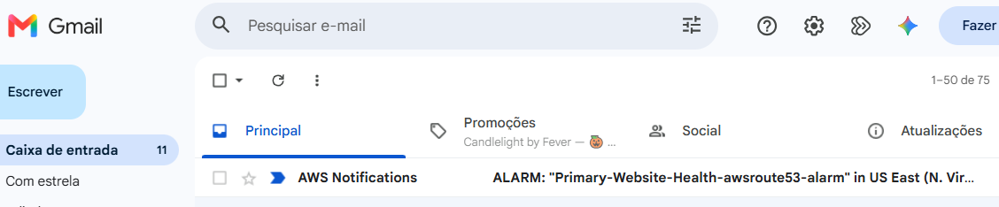

---

## 🐞 Dificuldades encontradas

| 🔴 Situação | 🔍 Causa | ✅ Solução |
|---|---|---|
| Site retornando **"Não encontrado"** em `/café` | O **tradutor automático do navegador** traduziu a página e acrescentou um acento: o caminho correto é `/cafe` | Desativar a tradução automática no console da AWS e usar `/cafe`, sem acento |
| O console **não tinha a opção de criar o alarme** no assistente do health check, como descrevia o enunciado | A interface atual cria o alarme pelo **CloudWatch** | Criar o alarme no CloudWatch com a métrica `HealthCheckStatus`, estatística **Mínimo**, período de **1 minuto** e condição **menor que 1**, com um tópico SNS para o e-mail |

---

## 🧠 Aprendizados

- 🔁 O **roteamento de failover** usa dois registros com o **mesmo nome** e tipos **Primário** e **Secundário**
- ❤️ O **health check** é o que decide quando o registro primário deixa de ser usado
- ⏱️ O **TTL baixo (15 s)** e o intervalo de **10 s** fazem o failover acontecer mais rápido
- 🌎 Instâncias em **Zonas de Disponibilidade diferentes** protegem contra a falha de uma delas
- 📊 A métrica `HealthCheckStatus` vale **1** (íntegro) ou **0** (não íntegro), e o alarme dispara quando ela fica **menor que 1**
- 🔍 Um detalhe pequeno, como um **acento inserido pelo tradutor**, pode causar um erro difícil de achar
- 📚 Interfaces da AWS mudam: vale **entender o objetivo** do passo, e não só seguir o texto

---

## 🔐 Observação sobre os prints

> ⚠️ Os recursos, IPs e o domínio que aparecem nas imagens pertencem a um **ambiente temporário de laboratório**, já encerrado. Dados pessoais e credenciais foram cobertos. Em projetos reais, evite publicar IDs de conta, endereços de e-mail e chaves de acesso.

---

### 👩‍💻 Autora

**LUCIANA RB DE ASSIS**

⭐ Se este projeto foi útil, deixe uma estrela no repositório!

